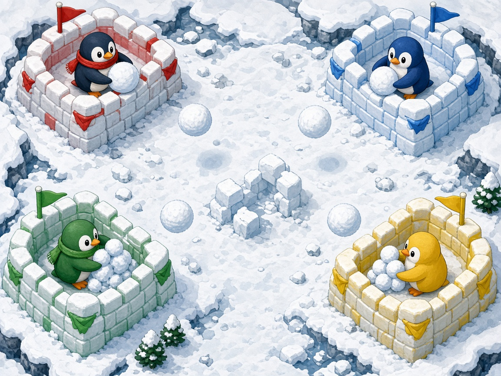

# Snowball Siege

Four penguins. Four corner forts. Three walls each. Pack a snowball, lob it in an arc, and be the last fort standing.

This is a local free-for-all for one to four players on a single screen. Empty slots can be bots, so it is playable solo. It runs in a browser from a tiny Python server, with no build step and no network once the page is open.

## Launch

Python 3 is required. The server binds to `127.0.0.1` on port **8805** (from `arcade.json`) and opens the game in your browser. If that port is taken, it tries the next free port.

| Platform | How |
| --- | --- |
| macOS | Double-click `launch-mac.command` |
| Windows | Double-click `launch-windows.bat` |
| Linux | `chmod +x launch-linux.sh` once, then `./launch-linux.sh` |

From a terminal you can also run `python3 server.py`. If Python 3 is missing, the launcher says so and points at [python.org](https://www.python.org/downloads/).

## Controls

Throw is the action button: hold to pack snow, release to lob. A fuller pack flies farther and hits harder. Repair is the secondary button: hold it next to your own damaged wall.

| Player | Move | Throw | Repair |
| --- | --- | --- | --- |
| P1 | W A S D | F | G |
| P2 | Arrow keys | `/` | `.` |
| P3 | I J K L | `;` | `'` |
| P4 | Numpad 8 4 5 6 | Numpad 0 | Numpad Enter |
| Gamepad | Left stick or D-pad | A | B |

Pads 0–3 map to P1–P4. A connected pad overrides that player's keyboard and can be plugged in mid-match. Start pauses. Esc pauses from the keyboard. M mutes. The HUD shows a pad icon while that player's controller is connected.

On the join screen, your throw button takes the slot and your repair button cycles the slot through open, bot, and off. Enter or Start begins the match once a human has joined and at least two fighters are active.

The controls screen can rebind every keyboard key. Bindings, volume, mute, and the round target are saved in `localStorage` on this machine.

## Rules

Each penguin defends the fort in their corner. A fort has three walls, and each wall has its own hit points.

- Hold throw to pack a snowball. You move slower while packing. Release to throw. The arc marker shows where it will land.
- A short pack is a line drive. A full pack is a high lob that sails over penguins and comes down on a wall.
- Snowballs stun any other penguin they hit. Stunned penguins drop their snow and cannot move for a moment. Your own snow does not stun you or damage your fort.
- Hold repair beside a damaged wall to patch it slowly.
- When all three walls of a fort are broken, that penguin is out.
- The last fort standing wins the round.

Power-ups appear on the ice:

| Pickup | Effect |
| --- | --- |
| Packed | A fully packed snowball, ready to throw |
| Swift | A burst of speed |
| Fortify | Repairs every wall of your fort |
| Heavy | The next snowball hits twice as hard |
| Shield | Snowballs cannot stun you for a few seconds |

## Scoring

The round winner gets one point. If the last forts fall on the same tick, the round is a draw and nobody scores.

The first penguin to win the target number of rounds wins the match. The target starts at 3 and can be set from 1 to 5 in Settings. The match screen shows the standings, then offers a rematch or a return to the title.

## arcade.json

`arcade.json` is the manifest for an arcade launcher:

- `name`, `id`, `version`
- `icon` and `cover` art
- `launch` commands for macOS, Windows, Linux, and the web page
- `players` 4, `minPlayers` 1 (solo versus bots)
- `input` keyboard and gamepad
- `port` 8805

## Tests

Core rules live in `src/core/` and do not touch the page, so they run headlessly. Rendering, keyboard and gamepad polling, and synthesized audio live in `src/ui/`.

```bash
node --test tests/
python3 tests/smoke_server.py
```

The Node tests cover movement and collision, throwing, elimination, scoring, round and match wins, power-ups, the seeded random stream, keyboard and gamepad mapping, and `arcade.json`. The Python test launches `server.py` without a browser and checks that it serves the game. GitHub Actions runs both.

## License

MIT. See [LICENSE](LICENSE).
